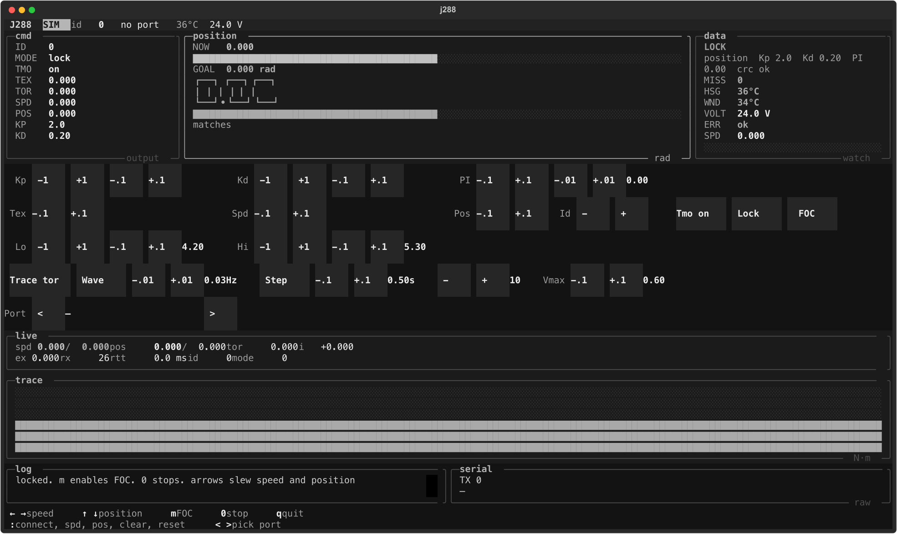

# J288 bench



Terminal dashboard for a Unitree J288 / S288 servo. The shaft stays locked until you enable FOC.

```bash
./launch-ui.sh
./launch-ui.sh /dev/cu.usbmodem...
./launch-ui.sh --sim
py -3 -m j288 COM5
```

The script creates `.venv` on first launch. Arrows slew speed and position, `m` enables FOC, `0` stops, `:` types a command, and `q` quits. Port `<` and `>` on the screen pick the adapter and open that device only. A typed `port` command does the same. Startup still tries each candidate, saved port first. The saved id is kept when it answers. Otherwise the first id that answers is selected.

Commands: `spd`, `pos`, `tor`, `kp`, `kd`, `ki`, `id`, `timeout`, `rate`, `port`, `connect`, `clear`, `reset`.

Gains, sweep limits, and the last port are written to `motor_settings.json` on quit. That file stays on this machine. Connect and probe lines go to `.log/j288_YYYY-MM-DD.log`. The folder keeps the latest five files.

```bash
.venv/bin/python -m pytest
```

## Several motors, one port

The wire is half duplex. `SerialBus.exchange` writes one command and waits for that reply before the next caller runs. Each `Motor` has its own command, feedback, and poll period. A motor that misses five replies in a row is polled at 5 Hz. Id 15 does not answer. A reset keeps only that motor quiet for 0.4 s. The screen is one of those motors.

```python
from j288 import SerialBus, Motor

bus = SerialBus()
bus.open("/dev/cu.usbmodem...")
motors = [Motor(0, bus), Motor(1, bus)]
motors[0].armed = True
motors[0].kp = 1.5
motors[0].cmd_pos = 4.7
for motor in motors:
    motor.poll()
bus.close()
```

## Code

- `j288/protocol.py` — command and reply frames, CRC, scaling, fault bits
- `j288/bus.py` — the shared port
- `j288/log.py` — connect and probe lines, five kept files
- `j288/motor.py` — one servo: command, feedback, poll timing
- `j288/bench.py` — the screen's motor: FOC, wave, and step
- `j288/ui.py` — the screen
- `vendor/` — Unitree's original Python example

The bus is 6 Mbps, 8N1. A mode 0 frame reads feedback while the shaft stays locked. macOS uses `/dev/cu.*`, Linux `/dev/ttyACM*` or `/dev/ttyUSB*`, Windows `COMn`.
